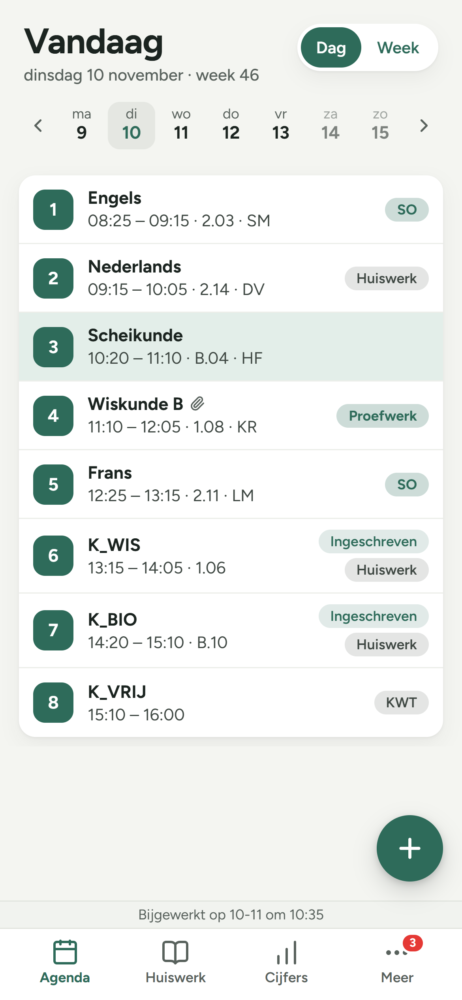
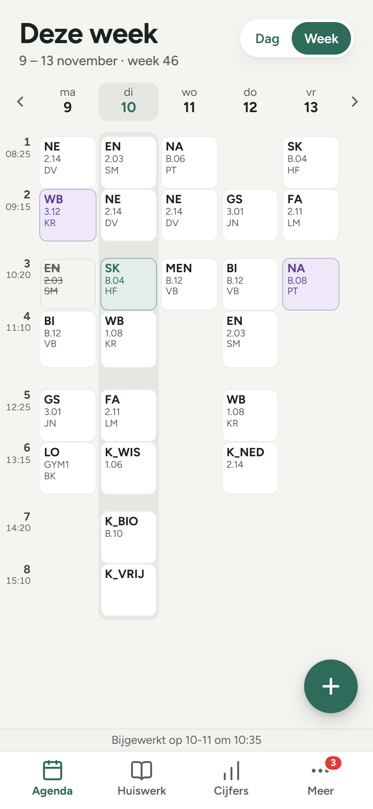
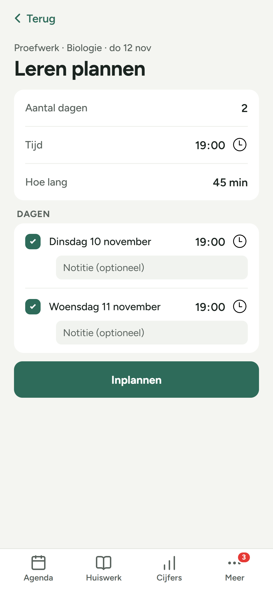
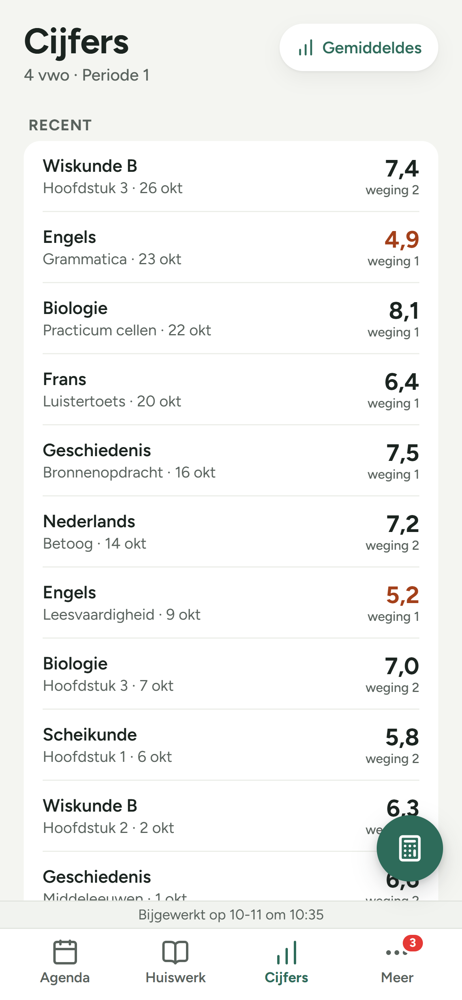

# Klas+

**Je schooldag, alles op een rij.**

Klas+ is een app voor leerlingen (en ouders) met je rooster, huiswerk, cijfers, berichten en meer. **Werkt met Magister:** je logt in met je Magister-account van school, en alles blijft op je telefoon. Er is geen server van Klas+ die meekijkt.

  
  
  
  

## Wat Klas+ extra doet

### Leren plannen voor je toets
Staat er een SO of proefwerk aan te komen? Tik op **Plan leren** en Klas+ weet al welk vak het is en wanneer de toets is.
- Eén kaart, drie keuzes: hoeveel dagen van tevoren, hoe laat en hoe lang.
- Daaronder je dagen. Vink een dag uit als je dan niet kunt, of geef hem een eigen tijd.
- Bij elke dag kun je kwijt wat je gaat leren, zoals "hoofdstuk 3".
- Je leermomenten verschijnen in je agenda én als persoonlijke afspraak op de schoolsite. Verschuif je er een op de site, dan neemt Klas+ dat gewoon over.

### Huiswerk inplannen
Hetzelfde, maar voor groter huiswerk: een verslag, een leesopdracht of een betoog. Tik op **Inplannen**, kies wanneer je eraan werkt, en het staat als "Huiswerk voor Engels maken" in je agenda.

### Je hele week in één oogopslag
Wissel rechtsboven tussen **Dag** en **Week**. De weekweergave zet je rooster op tijd neer, zodat je pauzes en tussenuren als gaten ziet.
- De les van nu (of die binnen een kwartier begint) is **groen**.
- Een ander lokaal of een andere docent? Dat uur is **paars**.
- Vervallen uren zijn doorgestreept.
- Afspraken voor de hele dag, of die over meerdere dagen lopen (zoals een toetsweek), staan als balk boven je rooster.
- Lange blokken, zoals een excursie, laten hun tekst gewoon doorlopen.
- Het weekend krijgt zijn eigen scherm, maar alleen als je er iets hebt staan. Anders veeg je meteen door naar volgende week.
- Avondafspraken staan netjes onder je rooster, zonder eindeloos scrollen.

### Ochtendmelding
Elke schooldag op een tijd die je zelf kiest: je eerste les, hoe laat en waar, en wat er die dag vervalt of verandert. Handig nog voordat je je bed uit bent.

### Rooster naar je eigen agenda
Kies een periode en zet je lessen in Apple Agenda of een andere agenda-app, met lokaal en huiswerk erbij.

### Ga ik over?
Vul de overgangsnormen van je school in en Klas+ rekent met je gemiddeldes van nu uit of je overgaat.

In je examenjaar (4 vmbo of mavo, 5 havo, 6 vwo) wordt dit vanzelf de **Examencheck**: per vak je SE en wat je op het centraal examen nodig hebt, en of je slaagt volgens de landelijke uitslagregel voor jouw niveau.

### Cijfercalculator
Wat doet een 6,5 met je gemiddelde? En wat moet je halen voor een 7? De calculator rekent mee terwijl je typt.

### Jouw stijl
Licht, donker of systeem. Groen, blauw of roze. En op iPhone past het app-icoon zich aan als je beginscherm donker of getint is.

### En nog iets
Ergens onderin de app telt Klas+ af naar de volgende vakantie. Zoek maar.

## Alles wat je verder verwacht

**Agenda**
- Je dag met lessen, labels (SO, proefwerk, huiswerk, wijziging, vervallen) en de les van nu uitgelicht.
- Vegen naar de volgende dag of week. Tik nog een keer op Dag of Week om terug te gaan naar vandaag.
- Eigen afspraken maken, aanpassen en verwijderen; ze staan ook in je schoolagenda.

**Huiswerk**
- Per week al je huiswerk en toetsen.
- Afvinken als je klaar bent, en dat zie je ook op de schoolsite.

**Cijfers**
- Je nieuwste cijfers met weging, en je gemiddeldes per vak.

**Meer**
- **Berichten:** lezen, schrijven, beantwoorden en doorsturen.
- **Opdrachten:** wat je moet inleveren, en de feedback van je docent.
- **Activiteiten:** inschrijven voor de sportdag of excursie, en zien wanneer de inschrijving sluit.
- **Afwezigheid:** je overzicht van dit jaar, wat er gemeld is, en afwezig melden als je school dat toestaat.
- **Leermiddelen:** je digitale methodes, met één tik open bij de uitgever.
- **Studiewijzers:** de planning per vak, als je docent die gebruikt.

**Meldingen**
- Een melding bij een nieuw cijfer, een uur dat vervalt of wijzigt, een huiswerkherinnering en de ochtendmelding.

**Overal**
- Werkt offline met de laatst opgehaalde gegevens.
- Omlaag vegen om te vernieuwen, terugvegen naar de vorige pagina.
- Altijd Nederlandse tijd, ook in het buitenland.
- Voor ouders: wissel tussen je kinderen.

## Privacy
- Je logt in op de inlogpagina van je school; Klas+ ziet je wachtwoord nooit.
- Je inlogsleutel staat in de beveiligde opslag van je telefoon.
- Er is geen server van Klas+: je gegevens gaan alleen tussen je telefoon en je school.
- Uitloggen wist alles van je telefoon.

*Klas+ is een onofficiële app. Hij werkt met Magister, maar is niet gemaakt door of verbonden aan Magister, Iddink of je school. Magister is een merk van zijn eigenaar.*

© 2026 Luuk van Embden
